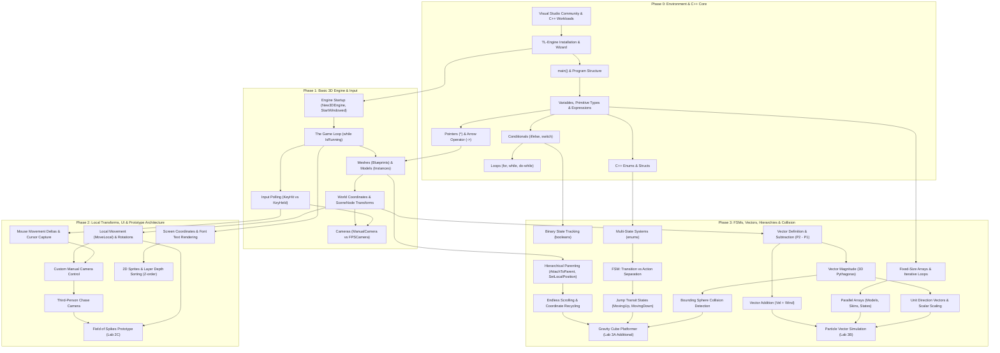

# CO1301 Games Concepts (2026-27) Module Rundown & Study Guide

This document is the verified factual rundown of UCLan Cyprus module **CO1301: Games Concepts** (also labelled **CO1035** across teaching materials) for the academic year 2026-27. It is derived exclusively from the official module descriptor, Blackboard handouts, lecture slide decks, lab worksheets, math practice sheets, and TL-Engine 11 C++ header files.

---

## 1. Module Overview & Structure

- **Module Code**: CO1301 / CO1035
- **Module Title**: Games Concepts
- **Credit Value**: 10 ECTS (20 UK Credits)
- **Delivery**: Semesters 1 & 2 (2 hours lecture + 3 hours supervised lab per week)
- **Instructors & Authors**:
  - Original material developed by: Gareth Bellaby, Laurent Noel, Nick Mitchell, and Misbahu Zubair.
  - 2026-27 Module Tutor: Aimilios Hadjiliasi (`ahadjiliasi1@uclan.ac.uk`).
- **Student Game Studio**: UCLan Cyprus hosts **Rays and Vectors Game Studio**, a student-led studio at the InSPIRE lab simulating commercial studio conditions (concept development, role rotation, milestone reporting, and Gold Master releases).
- **Core Thematic Threads**:
  1. *Game Mechanics*: Gameplay design, mechanics analysis, balance, and player feedback.
  2. *Commercial Processes*: Studio business models, development phases, team roles, pitching, and censorship/ratings.
  3. *Basic Game Development*: C++ game programming, game loops, model manipulation, cameras, player input, UI, and finite state machines using the TL-Engine.
  4. *Mathematics for Games*: Trigonometry, Cartesian coordinate geometry, 3D vectors, dot/cross products, matrices, Euclidean distances, and collision geometry.

---

## 2. Official Environment Setup Instructions

The setup procedure is defined in `Setting-up my Development Environemnt___Setup Programming Environment.pdf` and `TL-Engine11 ReadMe.txt`:

1. **Hardware & Operating System**:
   - Windows 10 (Creators Update or above) or Windows 11.
   - Mac users must run a Windows Virtual Machine; TL-Engine does not run natively on macOS.
2. **Visual Studio Installation**:
   - Download **Microsoft Visual Studio Community** (2022 or higher) from `https://visualstudio.microsoft.com/downloads/`.
   - In the Visual Studio Installer, select two mandatory workloads:
     - **Desktop development with C++**
     - **Game Development with C++**
   - Click **Install**, wait for completion, click **Finish**, and **restart your computer**.
3. **TL-Engine Installation**:
   - Download the engine archive from Blackboard (`TL-Engine11 1.0 Alpha7.zip` or `TL-Engine11 1.0 Alpha6`).
   - Run the installer and accept default installation paths (`C:\ProgramData\TL-Engine\Media` for media assets).
   - **Restart your computer** after engine installation.
4. **Creating a New Project**:
   - Open the Windows Start menu, type `TL11`, and select **Create New TL11 Project...** (or launch `TemplateWizard.exe` from the TL-Engine directory).
   - In the wizard, select **Visual Studio 2022** (works seamlessly even if newer VS editions are present).
   - Enter your project name and browse to a convenient directory, then click **OK**.
5. **Resolving Dependencies**:
   - When Visual Studio opens the generated project, it may display a banner for missing dependencies.
   - Click **Install all** in the top-right corner, click **Apply**, wait for installation, and restart if prompted.
6. **Verification Run**:
   - In Solution Explorer, open the `.cpp` file under the project.
   - Click **Local Windows Debugger** (or press `F5`).
   - The solution compiles and launches two windows: a console window and an empty 3D graphics window.

---

## 3. Week-by-Week Syllabus & Lab Build Specifications

### Week 1: Introduction, C++ Fundamentals & The Games Industry

#### Lectures
- **Lecture 1A (Introduction to the Module)**: Module structure, 4 threads, BCS/ETEK accreditation, Rays & Vectors studio, assessment weighting (40% Assignment 1, 60% Assignment 2).
- **Lecture 1B (The Commercial Games Industry)**:
  - *Key Players*: Hardware Manufacturers (Sony, Microsoft, Nintendo), Studios/Developers, Publishers (EA, Ubisoft, Riot), Retailers (physical stores like GameStop, digital platforms like Steam).
  - *Studio Tiers*: AAA (massive budgets, global releases), AA (moderate budget), Indie (small/self-funded), Outsourcing/Support (art/animation services).
  - *4 Development Phases*:
    1. **Concept Phase**: Core idea, visual style, mechanics, concept document, pitch to publishers, milestone contracts.
    2. **Pre-Production Phase**: Technical architecture, engine choice, playable demo, staffing, full Game Design Document (GDD).
    3. **Production Phase (~50% of lifecycle)**: Alpha (feature-complete, final asset integration, bug finding) -> Beta (all assets in, bugs squashed, player testing) -> Gold Master disc release.
    4. **Post-Production Phase**: Patches, maintenance, updates, and DLC.
  - *4 Core Disciplines*: Management (Producers), Programmers (mechanics/logic/APIs), Artists (3D models, animation, 2D art), Designers (gameplay, level, narrative, systems).

#### Labs
- **Lab 1A (Introduction to C++)**:
  - *Concepts*: `main()` entry point; `<iostream>` (`cout`, `cin`); primitive data types (`int`, `float`, `double`, `bool`, `char`, `string`); floating-point division requirements; `if / else if / else`; `switch / case / default / break`; logical operators (`&&`, `||`, `!`) and short-circuiting; `for`, `while`, and `do-while` loops; nested loops; 1D fixed-size arrays; modular functions; and user-defined `struct` types.
  - *Build Activities*: Console exercises including temperature conversion, leap year evaluation, factorials, ASCII patterns (square, right-angled triangle, diamond), array aggregations, and `struct Rectangle` perimeter/area calculators.
- **Lab 1B (Introduction to TL-Engine & Game Programming)**:
  - *Concepts*: Game code lifecycle (initialization, `while (myEngine->IsRunning())` loop, termination cleanup with `myEngine->Delete()`); `Mesh` blueprint vs `Model` scene instance; Cartesian coordinate system (left-handed: X horizontal, Y vertical, Z depth into scene); translation (`MoveX/Y/Z`) and rotation (`RotateX/Y/Z`).
  - *Build Activities*:
    - **The Giant**: Load `"Cube.x"` (10x10x10 units) and instantiate 15 separate `Model` instances arranged on a 2D coordinate blueprint at `Z = 0`.
    - **The Pyramid**: Multi-tier structure composed of 9 base cubes, 4 middle cubes, 1 top cube, and an apex sphere rotating on its X-axis.
    - **Controlled Sphere**: Sphere translation bouncing between boundaries `X = -40` and `X = 40` while rolling.
- **Lab 1C (Conditionals & Player Input)**:
  - *Concepts*: Single-frame toggle input (`KeyHit`) vs continuous input (`KeyHeld`); mouse button handling; switching from automatic `FPSCamera` to controllable `ManualCamera`; stopping the engine via `Key_Escape`; global world movement (`MoveX/Y/Z`) vs local model movement (`MoveLocalX/Y/Z`).
  - *Build Activities*:
    - **Lab1C_Controls_Project**: Controllable model using WASD for horizontal plane translation, Q/E for vertical movement, and Z/X for local steering.
    - **Lab1C_TestingVariables_Project**: Sphere translation with reverse (`'R'`) and pause (`'P'`) state toggles.
    - **Lab1C_SquarePath_Project**: Sphere traversing a continuous square loop along coordinate boundaries `(-75, 75)` to `(75, 75)` to `(75, -75)` to `(-75, -75)` on a floor mesh.

---

### Week 2: Game Design Documentation, Censorship & Advanced Engine Features

#### Lectures
- **Lecture 2A (Game Design Documentation)**:
  - *4 Document Types*:
    1. **High Concept Document**: 1-page summary; game title, genre, elevator pitch, core hook, target audience, key unique features.
    2. **Concept Document**: Structured proposal (indie 2–4 pages, medium 5–10, large 10–15); visual tone, gameplay loop, mechanics, target market, monetization.
    3. **Pitch Document**: Sales presentation for investors/publishers; USP, art style, market potential, production budget, timeline.
    4. **Game Design Document (GDD)**: Comprehensive internal development blueprint ("the game on paper"); living document created in pre-production exclusively for development staff.
  - *GDD Core Chapters*: Title Page, Game Overview (FAQs, background vs gameplay), Game World (levels, scale, travel/progression), Characters (player profile, NPCs, attributes, abilities, progression), Objects (key items, inventory, interactive elements, stats), User Interface (On-Screen Display [OSD], camera viewpoint, controller scheme), Play Modes (single/multiplayer variations, save restrictions), Appendices (tables, asset lists, technical references).
- **Lecture 2B (Censorship & Rating Systems)**:
  - *Regulatory Mechanisms*: Censorship (content modification/bans by governments or platforms) vs Rating Systems (age classification and content advice).
  - *Censored Categories*: Extreme violence, sexuality/nudity, political/ideological symbols, religious themes, and drug/gambling depiction.
  - *Global Case Studies*: Germany (Nazi symbolism banned until 2018 in *Wolfenstein*), UK (*Manhunt 2* initially banned by BBFC in 2007 for violence), China (*PUBG* rebranded to *Game of Peace*), Australia (*Fallout 3* real-world drug references censored).
  - *Rating Boards*: PEGI (EU & UK: 3, 7, 12, 16, 18), ESRB (North America: eC, E, E10+, T, M, AO), BBFC (historic UK film/game classifier replaced by PEGI in 2012), CERO (Japan), USK (Germany), ACB (Australia). Cyprus officially supports PEGI but lacks domestic statutory legislation.

#### Labs
- **Lab 2A (Texture Manipulation, Mouse Control & Custom Camera)**:
  - *Concepts*: Texture skin swapping via `model->SetSkin("skin.jpg")`; relative mouse displacement deltas (`GetMouseMovementX/Y`); mapping mouse X deltas to model Y-rotation and mouse Y deltas to X-rotation; locking the cursor with `StartMouseCapture()` and `StopMouseCapture()`; building a custom first-person camera on a `ManualCamera`.
  - *Build Activities*: Sphere displaying planetary textures; manual FPS camera with WASD local movement and mouse look, featuring a TAB toggle to capture/release the mouse cursor.
- **Lab 2B (Drawing Sprites & UI Text)**:
  - *Concepts*: Font loading via `LoadFont()`; per-frame text rendering with `font->Draw()`; screen pixel coordinates (top-left origin `0, 0`, X right, Y down); horizontal (`LeftAlign`, `CentreAlign`, `RightAlign`) and vertical (`TopAlign`, `MiddleAlign`, `BottomAlign`) alignment; formatted strings via `<sstream>` `std::stringstream`; 2D sprites via `CreateSprite()` with Z-depth layering (`0.0f` front to `1.0f` back).
  - *Build Activities*: Arrow-key text positioner; live HUD scoreboard for cube shooting; 2D UI backdrop with `"BlackBall.jpg"` displaying live 3D coordinates.
- **Lab 2C (Field of Spikes Prototype)**:
  - *Concepts*: Multi-model scene setup (`floor.x`, `skybox.x`, `plane.x`); third-person chase camera updating camera X and Z offsets behind plane; mouse steering; projectile instantiation (`ball.x`), scaling, single-shot cooldown management (`ballFired`, `ballDistance`), launch direction orientation, and distance-based despawning (`ballMesh->RemoveModel(ball)`).
  - *Build Activities*: Flying plane prototype steering through 3D space, firing cannonballs along its forward vector, destroying spikes, with an on-screen HUD (coordinates, boundary warning, ammunition readiness, score ratio).

---

### Week 3: Finite State Machines, Vectors & Arrays

#### Lectures
- **Lecture 3A (Finite State Machines)**:
  - *FSM Definition*: Computation model consisting of a finite set of states, transitions, and triggers. An entity occupies exactly one state at any time.
  - *State Transition Diagrams (STDs)*: Start Node -> State Nodes (state name and action) -> Directed Arrows (trigger event/condition) -> End Node.
  - *Architectures*: Multiple interacting FSMs (game state, player state, NPC AI), sub-states, deterministic vs non-deterministic vs probabilistic vs hierarchical FSMs.
  - *Implementation Pattern*: State variables (`enum`), separating transition logic (event checking) from state action logic (per-frame loop execution).
- **Lecture 3B (Mathematical Vectors)**:
  - *Scalars vs Vectors*: Scalar has magnitude only; vector has magnitude and direction.
  - *Cartesian Conventions*: Left-handed 3D axes (X horizontal, Y vertical, Z depth).
  - *Vector Arithmetic*:
    - Displacement between points: $\vec{P_1P_2} = P_2 - P_1 = (x_2 - x_1, y_2 - y_1, z_2 - z_1)$.
    - Commutative addition: $\vec{v} + \vec{w} = \vec{w} + \vec{v}$.
    - Non-commutative subtraction: $\vec{v} - \vec{w} \neq \vec{w} - \vec{v}$.
    - Magnitude (length): $\|\vec{v}\| = \sqrt{x^2 + y^2 + z^2}$.
    - Normalization: $\hat{v} = \frac{\vec{v}}{\|\vec{v}\|}$ (unit vector of length 1).
    - Scalar multiplication: $k \cdot \hat{v} = (k \cdot x, k \cdot y, k \cdot z)$.

#### Labs
- **Lab 3A (Finite State Machines)**:
  - *Concepts*: Binary states using `bool` (`sphereExists`); pointer reuse vs fatal dangling pointer calls after `RemoveModel()`; multi-state handling using `enum EColourStates` across 7 rainbow textures; continuous action vs instant transition using `enum ERotationDirection`.
  - *Build Activities*: Sphere existence toggle on Return key; color cycler on Space key; 4-direction continuous spinner on arrow keys.
- **Lab 3A Additional (Platformer Prototype - "Gravity Cube")**:
  - *Concepts*: Hierarchical parenting with `AttachToParent()`; local positioning with `SetLocalPosition()`; infinite side-scrolling illusion by moving backgrounds left at `kGameSpeed = -0.05f` and recycling past `X <= -260`; FSM jump states with transit states (`MovingUp`, `MovingDown`) and 90-degree flips; 3D bounding sphere collision detection using Euclidean center distance.
  - *Build Activities*: Complete endless runner platformer featuring gravity-flipping cube jumping between top and bottom platforms, moving obstacles, and collision-based game termination.
- **Lab 3B (Math Vectors, Arrays & Loops)**:
  - *Concepts*: Applying 3D velocity vectors via `Move(x, y, z)`; vector addition combining velocity and wind drift; array allocation of model pointers (`IModel* particleModels[kParticles]`); iterative creation, translation, and screen-edge recycling in `for` loops; parallel arrays coupling models, skins, and `MovementStates` enums (`Moving`, `Paused`).
  - *Build Activities*: Multi-particle falling snow simulator with wind deflection, array-based horizontal spacing, individual pause toggles using number keys `0`–`4`.
- **Math Practice (Vectors Exercise Sheet)**:
  - *Calculations*: Solving vector subtraction between 2D/3D points, vector addition, scalar scaling, vector lengths, and normalized direction vectors.

---

## 4. Concept Prerequisite Path

The following flowchart illustrates the dependency path from zero knowledge up to building the Week 3 endless platformer and vector simulations:

---

## 5. Assessment Details & Missing Information

### What Is Known
- **Assessment Structure**: Lecture 1A slide 13 specifies two programming assignments:
  - **Assignment 1**: 40% of module grade.
  - **Assignment 2**: 60% of module grade.
- **Module Descriptor Assessment**: States assessment consists of a portfolio of games and an in-class maths test (an institutional descriptor discrepancy).
- **Blackboard Page Structure**: The Blackboard space contains a folder under `/Assessments/Assessment 1/CO1035 - Assignment 1 Brief/` with page content introducing the coursework.

### UNKNOWN — Need the Brief from Blackboard
The actual brief files were not distributed inside the text archive. The Blackboard page text explicitly lists:
> *"In this brief, you may find attached a list of ducuments:*
> 1. *The Assessment Brief;*
> 2. *Assignment Resources;*
> 3. *A document for guidance;*
> 4. *The report which you have to complete and submit;*
> 5. *The Coursework Cover Sheet.*
> *Below there is also a video showing how the game would look like."*

**Status**: None of these 5 documents or the demonstration video are present in the source files. 
**Rule**: Do not invent, guess, or assume the assignment topic, geometry, mechanics, coordinate numbers, rubrics, or deadlines until the official files are downloaded directly from Blackboard.

---

## 6. Discrepancies and Pitfalls Reference

Students and instructors should be vigilant regarding the following discrepancies and errors identified across the course documents:

1. **Legacy Type Names vs TL-Engine 11 Headers**:
   - The lab worksheets and Appendices 1–3 use older TL-Engine nomenclature (`I3DEngine`, `IMesh`, `IModel`, `ICamera`, `ISprite`, `IFont`, `kTLX`, `kManual`, `kFPS`, `kLeft`, `kCentre`, `kRight`, `kWhite`).
   - The real C++ headers (`sources/tl-engine11_headers/*.h`) define modern names (`TLEngine`, `Mesh`, `Model`, `Camera`, `Sprite`, `Font`, `TLXStandard`, `ManualCamera`, `FPSCamera`, `LeftAlign`, `CentreAlign`, `White`).
   - Although `LegacyNames.h` provides backward compatibility `#define` and `using` aliases, students should write modern TL-Engine 11 types.
2. **Mouse Movement Return Type Mismatch**:
   - `TL-Engine Appendix 1.pdf` documents `GetMouseMovementX()` and `GetMouseMovementY()` as returning `int`.
   - The actual header `3DEngine.h` declares them returning `float`. Assigning to `int` truncates fractional mouse deltas.
3. **Key Code Name Discrepancy**:
   - Appendix 2 lists the decimal point key as `Key_DecimalPoint`.
   - `Input.h` defines this key code as `Key_Decimal = 0x6E`.
4. **Hardware Delay Loop vs Modern Frame Timing**:
   - Lab 1B page 6 instructs students to throttle FPS camera speed using an empty busy-wait loop: `for(int delay=0; delay < 1000000; delay++);`.
   - Modern engines should use `myEngine->FrameTime()` (returning delta time $dt$ in seconds) to scale translations, or call `myEngine->EnableVsync(true)`.
   - Lecture 3A slide 24 uses `dt` in `sphere->MoveX(sphereSpeed * dt);`, but the lab handouts never formally instruct students on calling `myEngine->FrameTime()`.
5. **Lecture 3A Slide 24 Syntax Typo**:
   - Slide 24 illustrates state transitions with `if (sphere->GetX() > 40.0f) sphereState == Up;`.
   - This uses equality comparison (`==`) rather than assignment (`=`), resulting in a silent no-op bug where the state never updates.
6. **Lab 2C Variable Name Mismatch**:
   - Page 4 instructs students to declare a boolean named `ballDirectionSet`.
   - The sample code on page 5 checks and modifies `firedDirectionSet`.
7. **Lab 2B Sprite Method Casing Error**:
   - Page 5 line 154 writes `backdrop->moveX(0.1f);` with a lowercase `m`. In C++, method names are case-sensitive; the valid header method is `MoveX(float x)`.
8. **Maths Practice Vectors Solution Arithmetic Error**:
   - In `CO1035 - Maths Practice - Vectors.pdf` page 3, solution 2d states:
     $$4d = 4(0, 13, 8) = (4 \times 0, 4 \times 13, 4 \times 8) = (4, 52, 32)$$
   - The first component $4 \times 0$ was erroneously recorded as $4$ instead of $0$.
9. **Assessment Specification Contradiction**:
   - Lecture 1A slide 13 specifies two assignments (40% Assignment 1, 60% Assignment 2).
   - The official module descriptor states the module is assessed via a portfolio of games and an in-class maths test.
10. **Default Window Dimensions**:
    - Lab 2B page 3 claims default window resolution is $1280 \times 720$.
    - `3DEngine.h` defines `StartWindowed(int width = 1600, int height = 900)`.
11. **Dangling Pointers Upon Model Destruction**:
    - `mesh->RemoveModel(model)` removes a model from the DirectX scene graph but leaves the C++ pointer intact. Invoking any method on that pointer causes an immediate crash. Always update an accompanying boolean flag or set the pointer to `nullptr`.

---

## 7. Known Course Gaps

The course sources leave several practical areas unaddressed that students will need to bridge:
- **Assignment 1 Brief & Assets**: Complete absence of coursework specifications, asset archives, guidance notes, report templates, and video demonstration.
- **Delta-Time Integration**: Lecture 3A assumes delta time $dt$ in pseudo-code, but lab exercises do not demonstrate hooking `myEngine->FrameTime()` into movement equations.
- **Built-in Collision Detection**: `SceneNode` headers provide `EnableCollisions()`, but the labs exclusively teach manual Pythagorean sphere distance testing without explaining the engine-level collision system.
- **3D Rotations & Orientation Mathematics**: Labs teach single-axis rotation (`RotateX`, `RotateY`, `RotateZ`), but omit multi-axis orientation, gimbal lock prevention, and rotation matrix mathematics.
- **Audio & Sound**: Neither the TL-Engine 11 headers nor the teaching materials contain sound or audio APIs, despite sound effects being cited as an industry role.
- **Explicit Memory Deallocation**: Labs teach `myEngine->Delete()` for engine shutdown and `mesh->RemoveModel()`, but never cover `RemoveMesh()`, `RemoveFont()`, `RemoveSprite()`, or `RemoveCamera()`.
